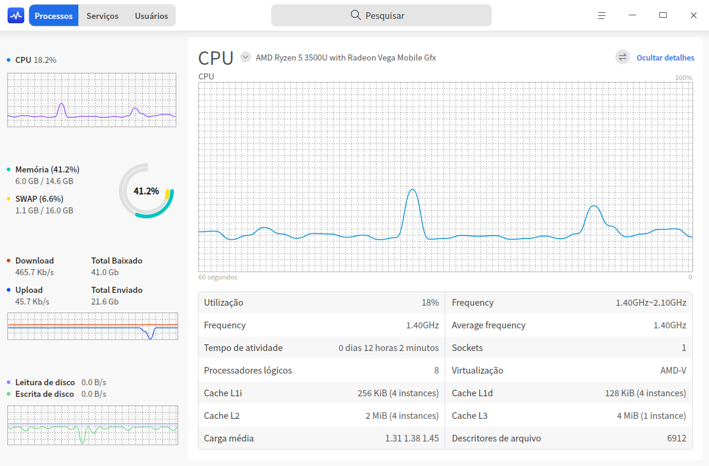
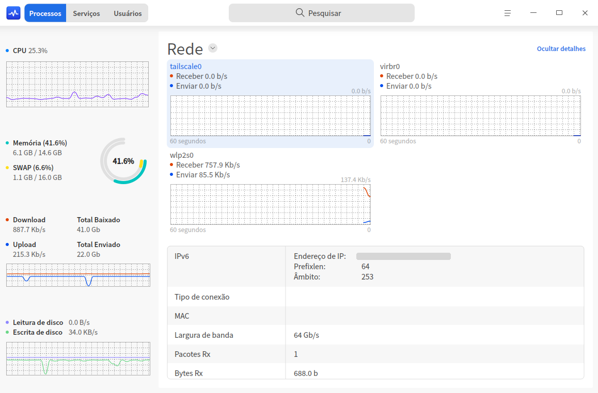
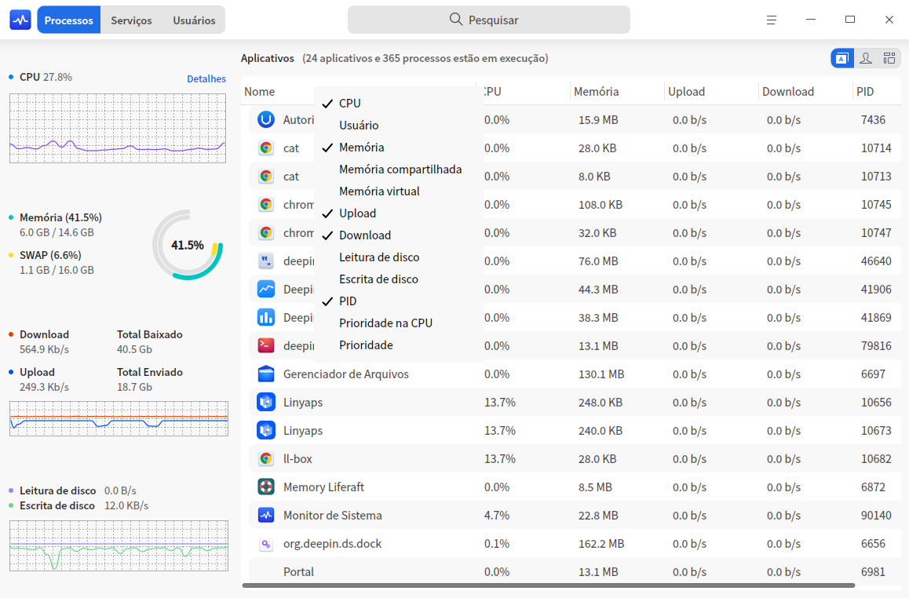
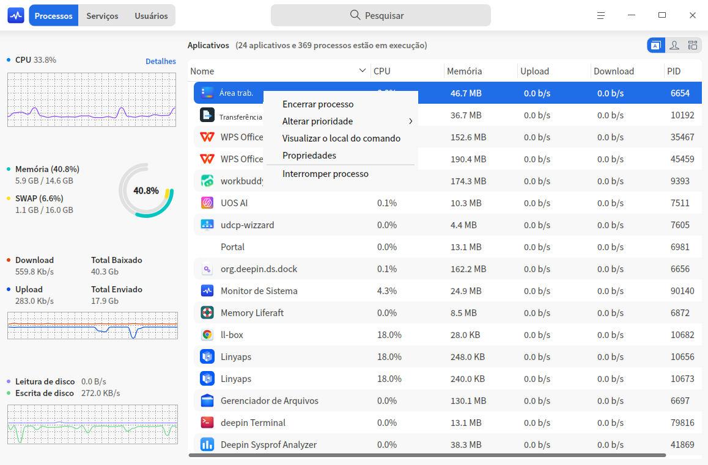
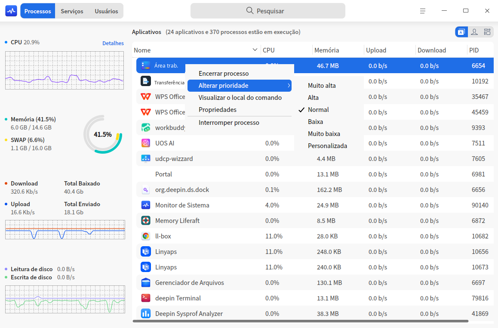
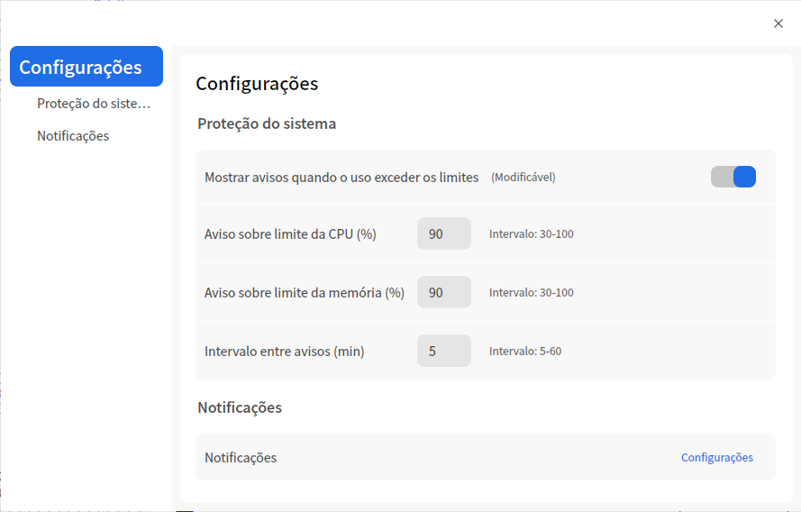

# Monitor do sistema|deepin-system-monitor|

## Visão geral

O Monitor do sistema é uma ferramenta do sistema para monitorar, consultar e gerenciar a carga de hardware, a execução de programas e os serviços do sistema. Ele monitora em tempo real o estado do processador, a taxa de uso da memória e a velocidade de upload e download da rede, gerencia processos do sistema e processos de aplicativos e também permite pesquisar processos e encerrá-los à força.

## Operações

### Pesquisar processos

1. No campo de busca do Monitor do sistema, clique em .
2. Digite a palavra-chave; os resultados são exibidos em tempo real.

### Monitoramento de hardware

Na aba de processos do Monitor do sistema, clique em  > **Exibir** e escolha o modo "Expandido" ou "Compacto" para exibir as informações de processador, memória, rede e disco do computador.

| Nome | Descrição |
| ------------------- | ---------------|
| Processador |    Exibe a carga de execução do processador no período mais recente.    |
| Memória |   Exibe o total de memória e o uso atual, além do tamanho da área de troca (swap) e o uso atual.    |
| Rede |   Exibe em tempo real a velocidade atual de upload e download da rede.   |
| Disco |  Exibido apenas na visão "Compacto"; mostra em tempo real a velocidade atual de leitura e gravação do disco.  |

#### Consultar os detalhes do hardware

Você pode consultar os detalhes do hardware de uma das seguintes formas:
- Na aba de processos do Monitor do sistema, clique na área de processador, memória, rede ou disco à esquerda; os detalhes do item correspondente aparecem à direita.
- Na aba de processos do Monitor do sistema, clique em **Detalhes** à esquerda; os detalhes do processador são expandidos por padrão à direita. Clique no ícone  para abrir o menu suspenso e escolher os detalhes de memória, rede ou disco.
- Acesse **Centro de Controle > Personalização > Barra de tarefas** e marque **Monitor do sistema** no menu da área de plugins. O ícone  aparece na área de plugins da barra de tarefas; posicione o ponteiro do mouse sobre ele para ver os dados de processador, memória e rede e clique nele para iniciar o Monitor do sistema.

> Observação: na página de detalhes do processador, clique no botão  para alternar entre a utilização total e a utilização individual do processador. Clique em **Ocultar detalhes** para recolher a página de detalhes.

### Gerenciamento de processos de programas

#### Alternar entre as abas de processos

Clique nos ícones no canto superior direito da interface para alternar entre as abas de processos e ver, respectivamente, os aplicativos, os meus processos e todos os processos.

- Clique no ícone  para alternar para a página **Aplicativos**.
- Clique no ícone  para alternar para a página **Meus processos**.
- Clique no ícone  para alternar para a página **Todos os processos**.

#### Ordenar os processos

A lista de processos pode ser ordenada por processador, usuário, memória, memória compartilhada, memória virtual, upload, download, leitura de disco, gravação em disco, PID, Nice e prioridade, entre outros critérios.

- Na interface do Monitor do sistema, clique no título no topo da lista de processos para ordenar os processos por esse critério; clique novamente para alternar entre ordem crescente e decrescente.
- Na interface do Monitor do sistema, clique com o botão direito na barra de títulos no topo da lista de processos e desmarque um título para ocultar a coluna correspondente; marque novamente para exibi-la.

#### Encerrar um processo

Você pode usar o Monitor do sistema para encerrar processos de aplicativos.
1. Na interface do Monitor do sistema, clique com o botão direito no processo que deseja encerrar.
2. Selecione **Encerrar processo**.
3. Na caixa de diálogo exibida, clique em **Encerrar processo** para confirmar o encerramento.

> Observação: você também pode selecionar **Forçar o encerramento do processo** no menu de contexto. O encerramento forçado pode causar perda de dados; opere com cautela.

#### Encerrar um aplicativo gráfico

Você pode usar o Monitor do sistema para fechar processos gráficos na área de trabalho.

1. Na interface do Monitor do sistema, clique em .
2. Selecione **Forçar o encerramento de aplicativo**.   
3. Conforme a indicação na tela, clique na área de trabalho sobre a janela do aplicativo que deseja fechar.
4. Na caixa de diálogo exibida, clique em **Forçar encerramento** para confirmar o encerramento do aplicativo.

> Observação: para interromper a operação acima, pressione a tecla **Esc** do teclado e volte para a interface do Monitor do sistema.

#### Pausar e continuar processos

Você pode usar o Monitor do sistema para pausar e continuar processos.

1. Na interface do Monitor do sistema, clique com o botão direito em um processo.
2. Selecione **Pausar processo**; o processo pausado recebe uma etiqueta de pausa.
3. Clique com o botão direito no processo pausado e selecione **Continuar processo** para retomá-lo.

#### Alterar a prioridade do processo

1. Na interface do Monitor do sistema, clique com o botão direito em um processo.
2. Selecione **Alterar prioridade** para fazer o ajuste.
Você também pode definir a prioridade do processo manualmente.

#### Consultar o local do processo

1. Na interface do Monitor do sistema, clique com o botão direito em um processo.
2. Selecione **Ver o local do comando** para localizar a pasta em que o processo está.

#### Consultar as propriedades do processo

1. Na interface do Monitor do sistema, clique com o botão direito em um processo.
2. Selecione **Propriedades** para ver o nome do processo, a linha de comando e a hora de início.

### Gerenciamento de serviços do sistema

Você pode iniciar, parar, reiniciar e atualizar processos de serviços do sistema e definir o modo de inicialização deles.
Na lista de serviços do sistema, o encerramento forçado de aplicativos não é permitido.

> Atenção: para o bom funcionamento do sistema, não encerre os processos dos próprios serviços do sistema nem o processo raiz.

#### Iniciar um serviço do sistema

1. Na interface do Monitor do sistema, selecione a aba **Serviços do sistema**.
2. Selecione um processo de sistema que não esteja iniciado e clique com o botão direito em **Iniciar**.
3. A caixa de diálogo de autorização é exibida; digite a senha para autorizar, e o estado do serviço do sistema passa a "Iniciado".
4. Clique com o botão direito no processo de sistema e selecione **Definir modo de inicialização** para defini-lo como automático ou manual.
5. Clique com o botão direito em **Atualizar** para atualizar a lista de serviços.

#### Parar um serviço do sistema

1. Na interface do Monitor do sistema, selecione a aba **Serviços do sistema**.
2. Selecione um processo de sistema que esteja iniciado e clique com o botão direito em **Parar**.
3. A caixa de diálogo de autorização é exibida; digite a senha para autorizar, e o estado do serviço do sistema passa a "Não iniciado".
4. Clique com o botão direito em **Atualizar** para atualizar a lista de serviços.

Você também pode clicar com o botão direito em **Reiniciar** para reiniciar o serviço do sistema.

## Menu principal

No menu principal, você pode forçar o encerramento de aplicativos, alternar a visão, alternar o tema da janela, consultar o manual de ajuda e saber mais sobre o Monitor do sistema.

### Exibir

O Monitor do sistema oferece o modo expandido e o modo compacto; escolha o modo de exibição das informações de monitoramento conforme a sua necessidade.

1. Na interface do Monitor do sistema, clique em .
2. Selecione **Exibir** e escolha um modo de visualização.

### Configurações

Na interface do Monitor do sistema, clique em  e selecione **Configurações** para ajustar a proteção do sistema e as notificações.

- **Proteção do sistema**: desativada por padrão. Quando ativada, você pode definir um limite para cada item de **Uso de CPU**, **Uso de memória** e **Intervalo de alerta**; quando o sistema detecta que o valor monitorado ultrapassa o limite, envia uma notificação de alerta.
  
- **Notificações**: ativadas por padrão. Clique em **Configurações** para ativar ou desativar as notificações no Centro de Controle.

### Tema

O tema da janela inclui tema claro, tema escuro e tema do sistema.

1. Na interface do Monitor do sistema, clique em .
2. Selecione **Tema** e escolha uma cor de tema.

### Ajuda

Consulte o manual de ajuda para conhecer melhor o Monitor do sistema e usá-lo com mais facilidade.

1. Na interface do Monitor do sistema, clique em .
2. Selecione **Ajuda**.
3. Consulte o manual de ajuda do Monitor do sistema.

### Sobre

1. Na interface do Monitor do sistema, clique em .
2. Selecione **Sobre**.
3. Consulte a versão e a descrição do Monitor do sistema.

### Sair

1. Na interface do Monitor do sistema, clique em .
2. Selecione **Sair**.
